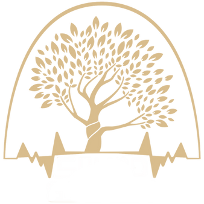
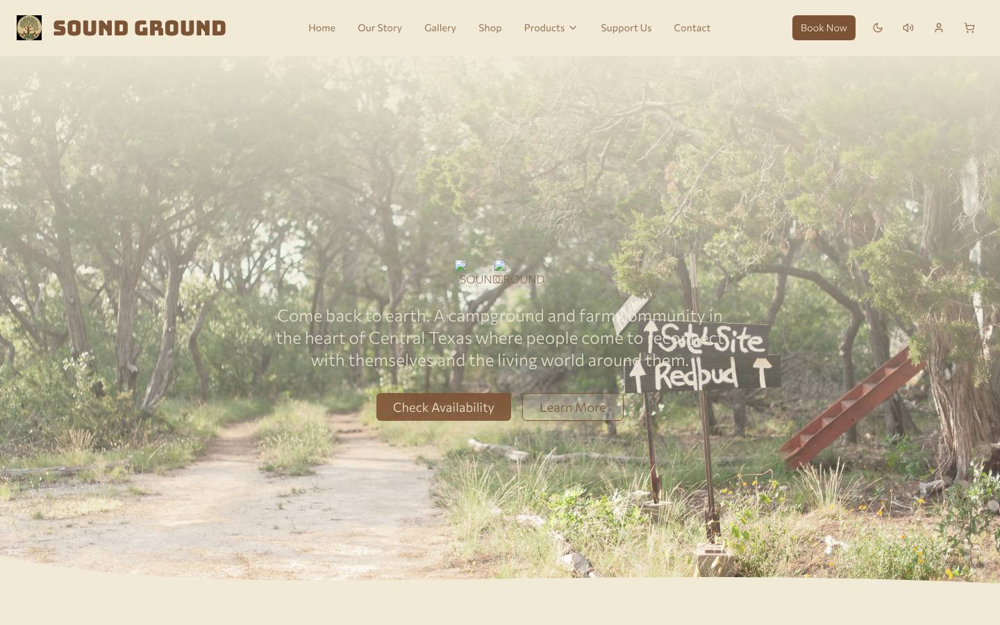
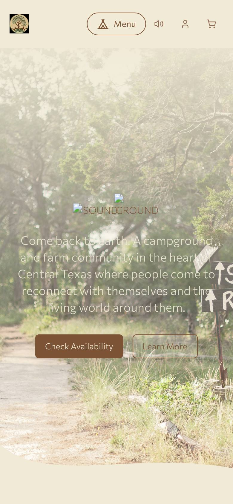

  

<h1 align="center"><a href="https://www.soundgroundtx.com">Sound Ground</a></h1>

The official website of Sound Ground, a 10-acre eco-campground, working farm and creative community in Blanco, Texas, in the Texas Hill Country. Guests can book a glamping bell tent or a primitive campsite, ask about the live-in residency, buy farm-grown microgreens and get tickets to music nights and workshops. Day mode plays birdsong; night mode turns on a starry sky and crickets.

<strong>Live site:</strong> <a href="https://www.soundgroundtx.com">soundgroundtx.com</a>

  <a href="#what-it-is">About</a> · <a href="#services">Services</a> · <a href="#features">Features</a> · <a href="#book-or-get-in-touch">Book</a> · <a href="#connected-brands">Connected brands</a> · <a href="#license">License</a>

  
  
  
  
  
  

<table>
  <tr>
    <td align="center" valign="top">
       
      Home page on desktop.
    </td>
    <td align="center" valign="top">
       
      The same page on a phone.
    </td>
  </tr>
</table>

## What it is

Sound Ground is part campground, part farm and part community, and the website has to carry all three. It is where a first-time visitor finds a campsite and books it, where someone thinking about living on the land learns how the residency works, and where locals pick up microgreens or a ticket to the next music night. It also tells the story of the place, shows it in photos and video, and gives directions out to Blanco.

Zathena Ventures designed, built and hosts the site.

## Services

- **[Campsites](https://www.soundgroundtx.com/products/campsites)**: [glamping bell tents](https://www.soundgroundtx.com/products/campsites?filter=Glamping) and [primitive sites](https://www.soundgroundtx.com/products/campsites?filter=Primitive), with availability and booking.
- **[Residency](https://www.soundgroundtx.com/products/residency)**: a long-term live-in program on the farm, with work-exchange, rental spots and community living.
- **[Community](https://www.soundgroundtx.com/products/community)**: live music nights, workshops and gatherings, with tickets.
- **[Sprouts and microgreens](https://www.soundgroundtx.com/products/sprouts)**: grown on the farm, filtered by type and size.
- **[Shop](https://www.soundgroundtx.com/shop)**: Sound Ground merch and farm goods.

## Features

### Plan a stay
- **Campsite booking**: browse and filter sites, check availability in real time and book, with a direct connection to Hipcamp.
- **Location and map**: an embedded map with property details and driving directions.
- **FAQs**: common questions answered on the [FAQs](https://www.soundgroundtx.com/faqs) page.

### Shop and events
- **Cart that stays out of the way**: a slide-out cart with subtotals by category, promo codes and a step-by-step checkout.
- **Event tickets**: add tickets for music nights and workshops straight to the cart.
- **Product options**: pick sizes and variants on each product.

### Feel of the place
- **Ambient audio**: birdsong in day mode, crickets and night forest in dark mode, with a mute button that remembers your choice across pages.
- **Day and night themes**: an animated starry sky in dark mode, saved between visits.
- **Gallery**: photos and video with tag filters, search and a full-screen viewer on the [Gallery](https://www.soundgroundtx.com/gallery) page.
- **Our story**: the story behind Sound Ground on the [Our Story](https://www.soundgroundtx.com/our-story) page.

### Community voice
- **Testimonials**: guest reviews, a form to add your own (checked before it goes live) and live Hipcamp reviews on the [Testimonials](https://www.soundgroundtx.com/testimonials) page.
- **Newsletter**: sign up from any main page and choose the topics you care about.
- **Support Sound Ground**: see how to help on the [Support Us](https://www.soundgroundtx.com/support-us) page.

### Access and reach
- **Accessibility panel**: color-blind simulation modes (protanopia, deuteranopia, tritanopia, high contrast) and a hover-to-read mode that speaks text aloud.
- **Floating helpers**: quick buttons for help and contact, accessibility and scroll to top.
- **Mobile first**: every page is designed for phones first.
- **Found in search**: each page is real HTML with its own title, description, share card and structured data describing a local lodging business.

## Book or get in touch

[Book a campsite](https://www.soundgroundtx.com/products/campsites), ask about the [residency](https://www.soundgroundtx.com/products/residency), or write through the [Contact](https://www.soundgroundtx.com/contact) page. Email: info@soundgroundtx.com.

## Connected brands

- **Built and hosted by** [Zathena Ventures](https://github.com/ZATHENA-VENTURES/ZathenaVentures-Public), the Fort Worth, Texas studio behind the site ([zathenaventures.xyz](https://zathenaventures.xyz)).

## License

© 2026 Sound Ground. All rights reserved.

## Credits & Contact

- **Website:** [soundgroundtx.com](https://www.soundgroundtx.com)
- **Contact:** info@soundgroundtx.com
- **Location:** Blanco, Texas, in the Texas Hill Country
- **Designed, built and hosted by:** [Zathena Ventures](https://zathenaventures.xyz)

> This is the public showcase of a private repository. It presents the project, its features and its live site, and leaves out source code and deployment details.
